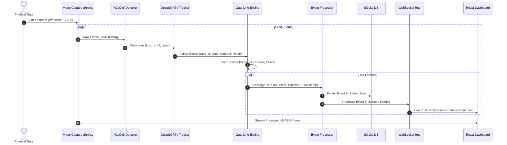

# System Architecture Specification
# AI-Based Smart Gate Monitoring System

## 1. Executive Summary
The Smart Gate Monitoring System provides automated, real-time surveillance, categorization, tracking, and directional counting of entities passing through facility access gates. The system supports both live camera sources (USB/webcam/RTSP) and pre-recorded surveillance videos.

---

## 2. Architectural Principles & Patterns

1. **Decoupled Layering**: The computer vision inference engine is fully decoupled from the event processing pipeline and web layer. Detections and tracks are exchanged via a strictly-typed schema.
2. **Deterministic Virtual Gate Geometry**: Movement classification does not rely on arbitrary bounding box collisions. Instead, it utilizes 2D vector geometry (signed cross products between movement trajectory segments and the virtual gate line segment) with debounce state machines.
3. **Pluggable Model Architecture**: Model loading is mediated through a single abstract interface (`ModelLoader`), enabling switching between pretrained weights (`yolov8n.pt`) and custom gate-tuned weights (`best.pt`) with zero changes to downstream code.
4. **Resilient Tracking & Occlusion Management**: The tracking system maintains trajectory histories per track ID. Brief tracking losses (e.g., pedestrian walking behind a post or car) are handled gracefully through trajectory interpolation and debounce windows, preventing duplicate counts.
5. **Real-Time Push & Pull APIs**: Real-time telemetry is pushed via WebSockets to connected dashboards, while historical data, filters, and configuration are served through high-performance REST APIs.

---

## 3. High-Level Data Flow Architecture

---

## 4. Pipeline Component Breakdown

### 4.1. Video Ingestion Layer (`backend/app/services/camera_service.py`)
- Interfaces with OpenCV `cv2.VideoCapture`.
- Accepts integer device indices (e.g., `0` for integrated webcam, `1` for USB external camera) or filesystem strings (e.g., `data/cctv_sample.mp4`).
- Runs in an asynchronous thread/task loop, buffering the latest frame to prevent pipeline stalls.
- Generates multipart MJPEG stream responses for web display.

### 4.2. Detection Engine (`backend/app/detection/`)
- Encapsulates Ultralytics YOLOv8.
- Filters predictions to the 6 target gate monitoring classes:
  - Class `0`: `person`
  - Class `1`: `bicycle`
  - Class `2`: `car`
  - Class `3`: `motorcycle`
  - Class `5`: `bus`
  - Class `7`: `truck`
- Configurable confidence threshold (default: `0.40`) and NMS IoU threshold (default: `0.50`).

### 4.3. Multi-Object Tracking Engine (DeepSORT Integration)
- Managed by Siddharth Chandrashekar.
- Associates detections across frames using spatial proximity (Kalman filter) and visual appearance embeddings.
- Yields persistent `track_id` values.
- Calculates object center $[c_x, c_y]$:
  $$c_x = \frac{x_1 + x_2}{2}, \quad c_y = y_2 \text{ (bottom-center for ground-plane accuracy)}$$

### 4.4. Gate Line Crossing & Direction Engine (`backend/app/counting/`)
The virtual gate line is defined by two 2D points $P_1(x_1, y_1)$ and $P_2(x_2, y_2)$ defining directed line segment $\vec{L} = P_2 - P_1$.
For an object moving from previous position $A(x_a, y_a)$ to current position $B(x_b, y_b)$, the algorithm computes:

1. **Line Segment Intersection**: Does trajectory segment $\overline{AB}$ intersect virtual gate segment $\overline{P_1 P_2}$?
2. **Vector Cross-Product Sign**:
   $$d = (x_2 - x_1)(y_b - y_1) - (y_2 - y_1)(x_b - x_1)$$
   The sign of $d$ indicates which half-plane the object moved into.
   - Transition from negative to positive $\rightarrow$ **ENTRY**
   - Transition from positive to negative $\rightarrow$ **EXIT**
3. **Debounce & Idempotency Window**: Once a track ID triggers an event, it enters a cooldown state for $N$ seconds or until its trajectory moves at least $D$ pixels away from the line threshold, preventing jitter/flutter around the line.

### 4.5. Persistence Layer (`backend/app/database/`)
- SQLite database (`gate_monitoring.db`) managed via SQLAlchemy 2.0 ORM.
- Tables:
  - `monitoring_events`: Discrete crossing instances with timestamp, track ID, class name, direction, confidence, and snapshot metadata.
  - `traffic_aggregates`: Hourly and daily rolling summaries of people and vehicle movements.
  - `system_alerts`: Security and operational alerts (e.g., counterflow movement, high congestion, camera feed failure).
  - `camera_configs`: Configured gate lines, active camera sources, and sensitivity settings.

### 4.6. Communication & Web Layer (`backend/app/api/`)
- FastAPI application serving CORS-enabled REST endpoints and standard ASGI WebSocket routes.
- Background worker task loops for frame processing and live telemetry dissemination.
