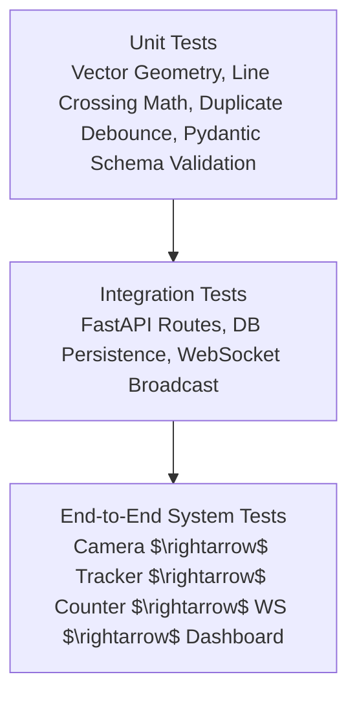

# Testing Strategy & Quality Assurance
# AI-Based Smart Gate Monitoring System

This document outlines the testing strategy, test layers, test execution instructions, and acceptance criteria.

---

## 1. Testing Pyramid & Scope



---

## 2. Unit Testing Suite

Located under `tests/unit/`:

1. **`test_model_loading.py`**:
   - Tests `ModelLoader` initialization with baseline and custom paths.
   - Verifies handling of non-existent weight paths.
   - Verifies device selection (`cpu`, `cuda`).
2. **`test_detection_output.py`**:
   - Validates detection and tracking output against the required dictionary schema (`track_id`, `class_id`, `class_name`, `confidence`, `bbox`, `center`).
   - Ensures bounding box coordinate constraints ($x_1 < x_2$, $y_1 < y_2$).
   - Validates confidence numeric range $[0.0, 1.0]$.
3. **`test_gate_line_crossing.py`**:
   - Tests geometric line intersection between trajectory segments and virtual gate lines.
   - Validates cross-product signed direction classification (Entry vs. Exit).
   - Tests edge cases: trajectory parallel to gate line, stationary object on line, trajectory stopping short.
4. **`test_duplicate_prevention.py`**:
   - Verifies that an object oscillating near the line is not counted multiple times within the debounce window.
   - Verifies track history timeout and cooldown expiration.
5. **`test_database_operations.py`**:
   - Tests SQLAlchemy session creation, table generation, and CRUD operations.
   - Tests event record creation, paginated querying, and hourly/daily aggregation logic.
6. **`test_api_endpoints.py`**:
   - Uses `httpx.AsyncClient` / FastAPI `TestClient` to verify all REST endpoints:
     - `POST /api/camera/start`, `POST /api/camera/stop`, `POST /api/camera/source`
     - `GET /api/monitoring/stats`, `GET /api/monitoring/events`
     - `GET /api/analytics/daily`, `GET /api/analytics/hourly`
     - `GET /api/alerts`

---

## 3. Integration Testing Suite

Located under `tests/integration/`:

1. **`test_monitoring_pipeline.py`**:
   - Feeds a sequence of synthetic frames through the camera service, detection module, tracking engine, and gate counter.
   - Asserts that events are generated and stored in SQLite correctly.
2. **`test_websocket_stream.py`**:
   - Connects an asynchronous WebSocket client to `/ws/monitoring`.
   - Triggers simulated gate crossing events.
   - Asserts received payload matches `GATE_CROSSING` and `STATS_UPDATE` schemas.

---

## 4. Test Execution Instructions

```bash
# Run entire test suite
pytest tests/ -v

# Run only unit tests
pytest tests/unit/ -v

# Run with test coverage report
pytest --cov=backend/app tests/ -v
```

---

## 5. Acceptance Criteria

- All unit tests pass with 0 failures and 0 errors.
- Test coverage on counting geometry and API routing $\ge 85\%$.
- No mocked test data claimed as real camera detections.
- Synthetic frames clearly isolated in test harnesses.
